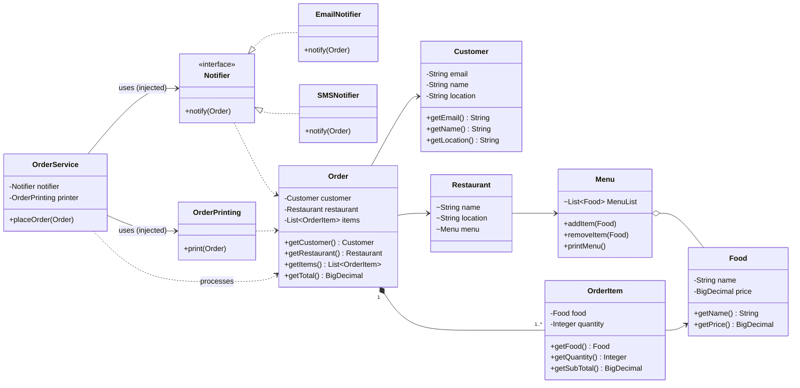
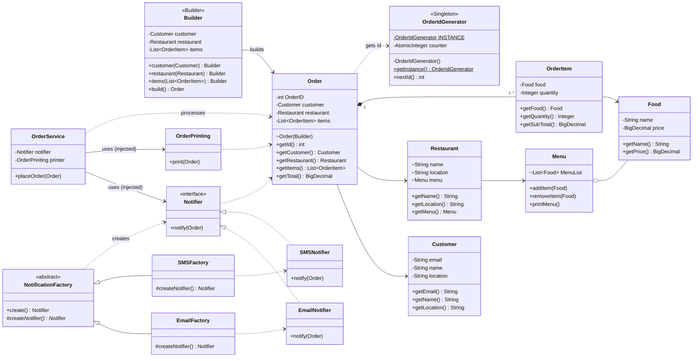
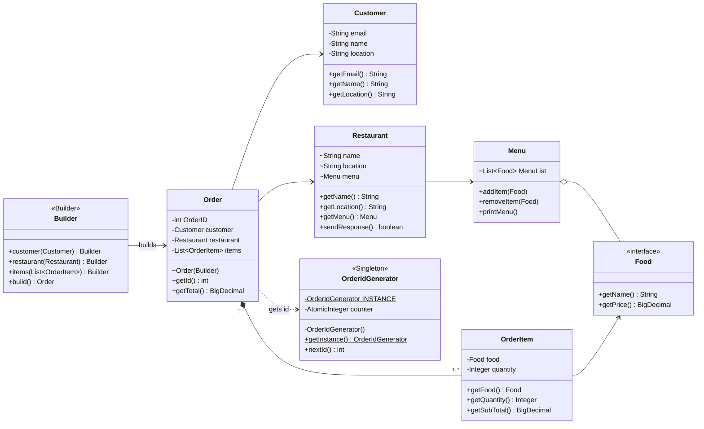
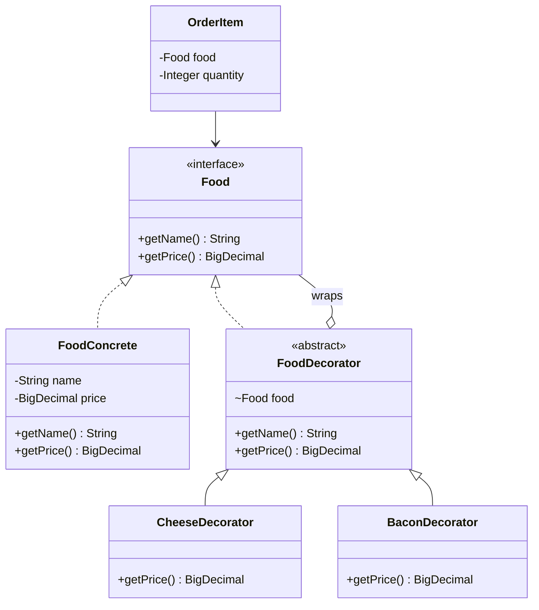
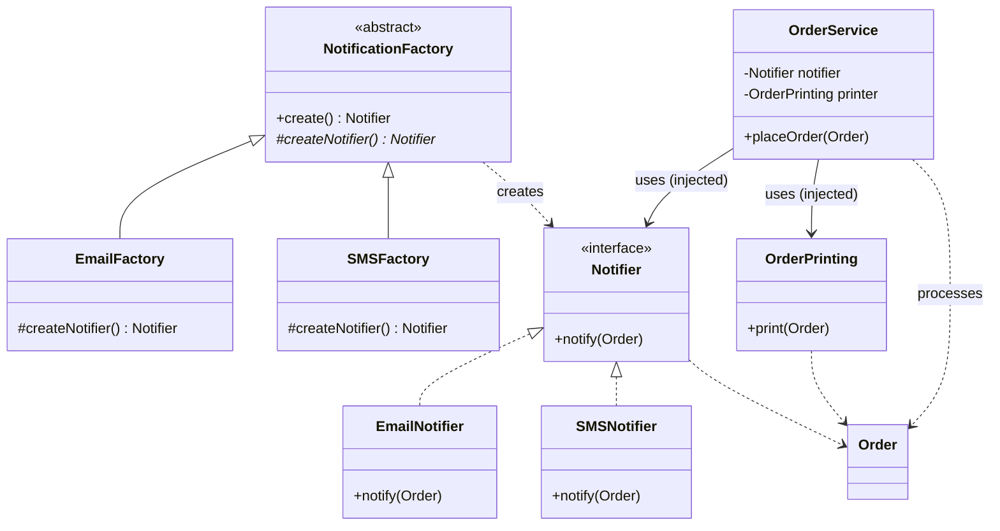
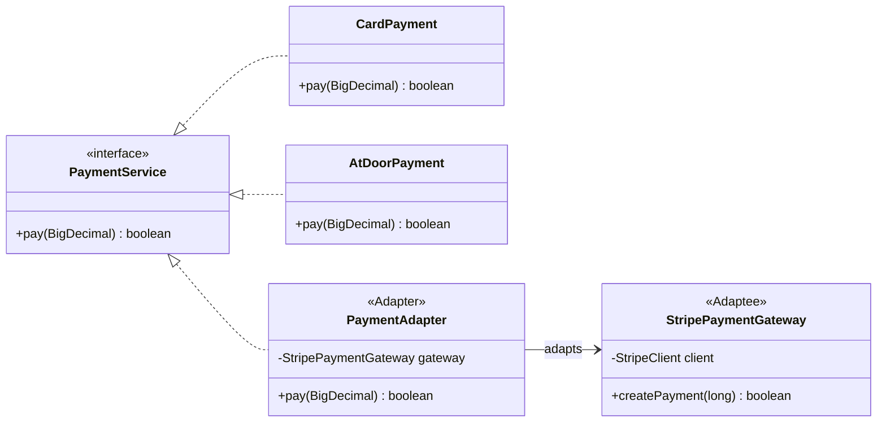
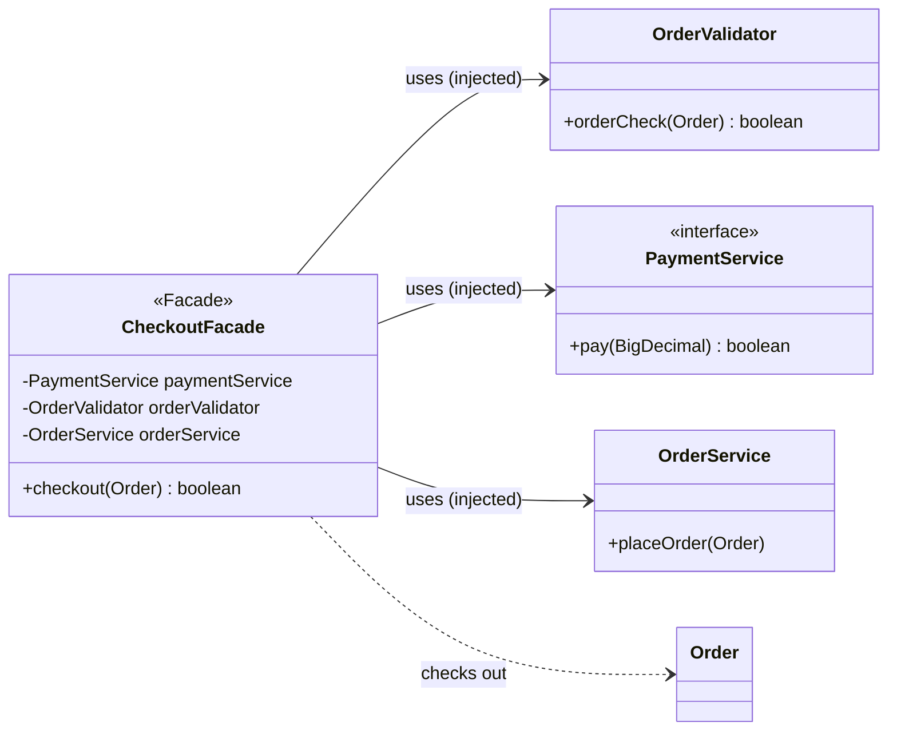

# Food Delivery: SOLID Refactoring Report
 
## 1. Project idea
 
A simple food delivery app: a **customer** orders **food** from a **restaurant**, the order is **placed**, the customer is **notified**, and the order details are **printed**.
 
## 2. What was done
 
| # | Change | Before | After |
|---|---|---|---|
| 1 | `Order` now holds a **list** of items | one `OrderItem` only | `List<OrderItem>`, immutable copy via `List.copyOf` |
| 2 | Total calculation | missing | `OrderItem.getSubTotal()` and `Order.getTotal()` |
| 3 | Money type | `float` | `BigDecimal` (exact, safe for prices) |
| 4 | Printing removed from `Order` | `Order.finalOrderDeatails()` printed itself | new `OrderPrinting` class |
| 5 | Notification abstraction | hardcoded `Notification` class | `Notifier` interface + `EmailNotifier` and `SMSNotifier` |
| 6 | Order workflow | empty `OrderService` | `OrderService.placeOrder(order)` coordinates notify + print |
| 7 | Dependency injection | none | `OrderService` receives `Notifier` and `OrderPrinting` through its constructor |
| 8 | `Main` role | built and printed everything | only creates objects, wires them, and starts the flow |
 
## 3. SOLID principles used
 
### S: Single Responsibility
Each class has one job:
- `Order`, `OrderItem`, `Customer`, `Food`: hold data (and compute their own totals)
- `OrderPrinting`: output formatting only
- `EmailNotifier`, `SMSNotifier`: sending one kind of notification each
- `OrderService`: coordinating the steps of placing an order
### O: Open/Closed
New notification channels (push, Telegram, ...) are added by **creating a new class** that implements `Notifier`. `OrderService` does not need to be edited.
 
### D: Dependency Inversion
`OrderService` depends on the `Notifier` **interface**, not on `EmailNotifier`. The concrete class is chosen in `Main` and injected through the constructor:
 
```java
OrderService service = new OrderService(new EmailNotifier(), new OrderPrinting());
```
 
Switching to SMS is a one-word change in `Main`: `new SMSNotifier()`.
 
### L: Liskov Substitution
`EmailNotifier` and `SMSNotifier` can replace each other anywhere a `Notifier` is expected, and `OrderService` works the same.
 
### I: Interface Segregation
`Notifier` has a single method, `notify(Order)`. Implementations are not forced to provide methods they do not need.
 
## 4. Class diagram
 

 
## 5. Flow of `placeOrder`
 
```
Main --creates--> EmailNotifier, OrderPrinting
Main --injects--> OrderService(notifier, printer)
Main --calls----> orderService.placeOrder(order)
                    ├─ notifier.notify(order)   (Email or SMS, decided by Main)
                    └─ printer.print(order)
```
 

 
## 6. Conclusion

In this lab, I learned the theoretical concepts of the SOLID principles and applied some of them to develop a simple food delivery project. I gained a better understanding of how to organize classes, separate responsibilities, and reduce dependencies between components. By implementing these principles, I learned how to make the code more readable, maintainable, and easier to extend with new functionality. This lab helped me understand the importance of good object-oriented design when developing software projects.


# Food Delivery: Creational Design Patterns Report
 
## 1. Project idea
 
A simple food delivery app: a **customer** orders **food** from a **restaurant**, the order is **placed**, the customer is **notified**, and the order details are **printed**.

In this lab the project from the previous lab was extended with three **creational design patterns**: **Builder**, **Factory Method** and **Singleton**.
 
## 2. What was done
 
| # | Change | Before | After |
|---|---|---|---|
| 1 | Creating an `Order` | `new Order(customer, restaurant, items)` | `Order.Builder` with chained methods and `build()` |
| 2 | Order identification | none | every order gets a unique `OrderID` |
| 3 | Unique id generation | none | `OrderIdGenerator` as a **Singleton** |
| 4 | Choosing the notifier | `Main` wrote `new EmailNotifier()` | `NotificationFactory` + `EmailFactory` and `SMSFactory` |
| 5 | `OrderService` creation | `new OrderService(new EmailNotifier(), ...)` | `new OrderService(factory.create(), ...)` |
| 6 | `Restaurant` | fields only | added `getName()`, `getLocation()`, `getMenu()` |
| 7 | `OrderPrinting` | no id, no restaurant details | prints the order id, the restaurant and its menu |
| 8 | Singleton comparison | none | `SingletonEager` and `SingletonLazy` in the `test/` folder |
 
## 3. Creational patterns used
 
### Builder
`Order` is made of several parts (customer, restaurant, items). Instead of a long constructor, the nested class `Order.Builder` collects the parts with chained methods, and `build()` creates the final `Order`. The `Order` constructor is not public, so an order can only be created through the builder.

```java
Order order = new Order.Builder()
        .customer(customer1)
        .restaurant(restaurant1)
        .items(List.of(new OrderItem(item3, 2)))
        .build();
```

New fields (note, delivery address, fee) can be added later as new builder methods without changing existing code.

### Factory Method
`NotificationFactory` is an abstract class with the factory method `createNotifier()`. `EmailFactory` and `SMSFactory` override it and decide which `Notifier` is created. The code that uses the notifier never writes `new EmailNotifier()`.

```java
NotificationFactory factory = new EmailFactory();
OrderService orderService1 = new OrderService(factory.create(), new OrderPrinting());
```

Switching to SMS is a one-word change in `Main`: `new SMSFactory()`. A new channel is added by creating one new notifier and one new factory, and `OrderService` does not need to be edited.

### Singleton
Every order needs a unique id, so the whole application must share **one** counter. `OrderIdGenerator` has a private constructor and a static instance that is reached only through `getInstance()`. The `Order` constructor asks it for the next id.

```java
this.OrderID = OrderIdGenerator.getInstance().nextId();
```

In the `test/` folder two variants were compared: **eager** initialization (the object is created when the class is loaded) and **lazy** initialization (created on the first `getInstance()` call). `OrderIdGenerator` uses the lazy one.

### Other creational patterns (not used)
**Abstract Factory** creates families of related objects, **Prototype** creates objects by copying an existing one, and **Object Pool** reuses ready objects. They were not needed here, because there is only one product type and nothing expensive to create.
 
## 4. Class diagram
 

 
## 5. Flow of `placeOrder`
 
```
Main --creates--> EmailFactory
Main --calls----> factory.create()  ->  EmailNotifier
Main --injects--> OrderService(notifier, printer)
Main --builds---> Order.Builder ... .build()
                    └─ OrderIdGenerator.getInstance().nextId()
Main --calls----> orderService.placeOrder(order)
                    ├─ notifier.notify(order)
                    └─ printer.print(order)
```
 
## 6. Conclusion

In this lab, I learned the theoretical concepts of creational design patterns and applied three of them to develop a simple food delivery project. The Builder made the creation of an order clearer and easier to extend, the Factory Method removed the choice of a concrete notifier from the code that uses it, and the Singleton guaranteed that only one id generator exists, so order ids are never duplicated. I also compared eager and lazy initialization of a singleton. By combining these patterns with the SOLID principles from the previous lab, I learned how to separate the creation of objects from their usage, which makes the code more flexible, maintainable, and easier to extend with new functionality.


# Food Delivery: Structural Design Patterns Report
 
## 1. Project idea
 
A simple food delivery app: a **customer** orders **food** from a **restaurant**, the order is **checked and paid**, the order is **placed**, the customer is **notified**, and the order details are **printed**.

In this lab the project from the previous labs was extended with three **structural design patterns**: **Decorator**, **Facade** and **Adapter**. The Adapter connects the app to an external API (**Stripe**, used in test mode).
 
## 2. What was done
 
| # | Change | Before | After |
|---|---|---|---|
| 1 | `Food` | a plain class | `Food` **interface** + `FoodConcrete` (the basic dish) |
| 2 | Extras on a dish | none | `FoodDecorator` with `CheeseDecorator` (+2.00) and `BaconDecorator` (+3.00) |
| 3 | Placing an order | `Main` called `orderService.placeOrder(order)` | `Main` calls one method: `CheckoutFacade.checkout(order)` |
| 4 | Order validation | none | `OrderValidator.orderCheck(order)` |
| 5 | Restaurant confirmation | none | `Restaurant.sendResponse()` (simulated acceptance) |
| 6 | Payment | none | `PaymentService` interface with `CardPayment`, `AtDoorPayment` and `PaymentAdapter` |
| 7 | External API | none | `StripePaymentGateway` uses the Stripe Java SDK (test mode, key from `STRIPE_SECRET_KEY`) |
| 8 | Money for Stripe | `BigDecimal` in euros | converted to `long` cents inside the adapter |
| 9 | Build | plain `javac` | `pom.xml` (Maven) with the `stripe-java` dependency |
| 10 | `Main` role | created `OrderService` and placed the order | creates the objects, wires them, and calls `checkout` |
 
## 3. Structural patterns used
 
### Decorator
Customers want extras on a dish (cheese, bacon). Creating a subclass for every combination (`CheeseSteak`, `BaconCheeseSteak`, ...) would produce too many classes. Instead, `Food` became an interface and `FoodConcrete` is the basic dish. The abstract `FoodDecorator` also implements `Food`, holds another `Food` inside, and passes the calls to it. `CheeseDecorator` and `BaconDecorator` override `getPrice()` and add their own price.

```java
Food steak = new FoodConcrete("Steak", BigDecimal.valueOf(13.50));
steak = new CheeseDecorator(steak);   // 13.50 + 2.00 = 15.50
steak = new BaconDecorator(steak);    // 15.50 + 3.00 = 18.50
```

A decorated food is still a `Food`, so `Menu`, `OrderItem` and `Order` work with it without any change, and decorators can be stacked in any order. A new extra (egg, sauce) is one new class.

### Facade
Placing an order now takes several steps: validate the order, ask the restaurant, take the payment, then notify the customer and print the order. Without a facade, `Main` would have to know all the steps and their order. `CheckoutFacade` hides them behind one method:

```java
boolean successful = checkoutFacade.checkout(order);
```

Inside, the facade stops and returns `false` as soon as a step fails (validation, restaurant, payment), and only a fully paid order reaches `OrderService.placeOrder`. Its dependencies (`PaymentService`, `OrderValidator`, `OrderService`) are passed through the constructor.

### Adapter
The Stripe SDK has its own API: `StripeClient`, `PaymentIntent`, amounts as `long` cents, and `StripeException`. Our app expects a simple `PaymentService` with `boolean pay(BigDecimal total)`. `PaymentAdapter` implements `PaymentService` and wraps `StripePaymentGateway`, which talks to Stripe in test mode (EUR, test card `pm_card_visa`, secret key read from the environment variable `STRIPE_SECRET_KEY`, so no key is stored in the code). The adapter:
- converts the total from euros to cents (`total * 100`, `longValueExact()`),
- calls `createPayment(amountInCents)`,
- turns a `StripeException` into `false`.

```java
PaymentService paymentService = new PaymentAdapter(new StripePaymentGateway());
```

The rest of the app only sees `PaymentService`, so `CardPayment`, `AtDoorPayment` and `PaymentAdapter` can replace each other. Changing the payment method is a one-line change in `Main`, and `CheckoutFacade` is not edited.

### Other structural patterns (not used)
**Bridge** separates an abstraction from its implementation, **Composite** treats a group of objects like one object (tree structures), **Flyweight** shares common data between many small objects, and **Proxy** controls access to another object. They were not needed in this project, because there is no tree structure, no large number of identical objects, and no access control.
 
## 4. Class diagrams

The full design is split into five smaller diagrams, one for each part of the project.

### 4.1 Domain model (with Builder and Singleton)



### 4.2 Decorator (food extras)



### 4.3 Notification (Factory Method) and order placing



### 4.4 Payment (Adapter)



### 4.5 Checkout (Facade)


 
## 5. Flow of `checkout`
 
```
Main --creates--> StripePaymentGateway
Main --creates--> PaymentAdapter(gateway)          (a PaymentService)
Main --creates--> CheckoutFacade(paymentService, validator, orderService)
Main --calls----> checkoutFacade.checkout(order)
                    ├─ orderValidator.orderCheck(order)      (false -> stop)
                    ├─ restaurant.sendResponse()             (false -> stop)
                    ├─ paymentService.pay(order.getTotal())  (false -> stop)
                    │     └─ PaymentAdapter: euros -> cents -> StripePaymentGateway.createPayment(cents)
                    └─ orderService.placeOrder(order)
                          ├─ notifier.notify(order)
                          └─ printer.print(order)
```
 
## 6. Conclusion

In this lab, I learned the theoretical concepts of structural design patterns and applied three of them to develop a simple food delivery project. The Decorator made it possible to add extras to a dish without creating a subclass for every combination, the Facade hid the steps of the checkout behind one method, and the Adapter allowed the app to use the Stripe API through the same simple payment interface as the other payment methods. Working with a real external API showed me why an adapter is useful: the rest of the code does not depend on the details of a third-party library, so it can be replaced or extended easily. By combining these patterns with the SOLID principles and the creational patterns from the previous labs, I learned how to organize classes and their relationships so that the code stays flexible, maintainable, and easier to extend with new functionality.