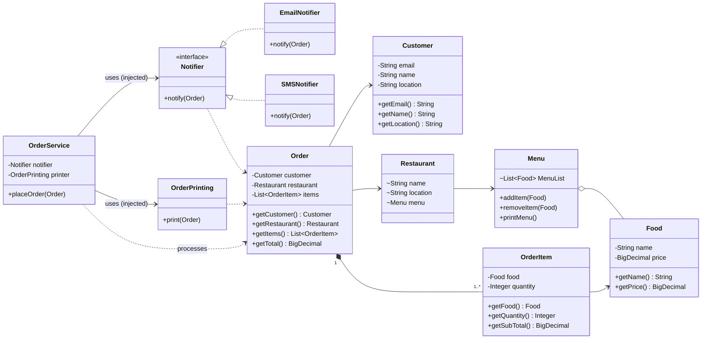

# Food Delivery: SOLID Refactoring Report
 
## 1. Project idea
 
A simple food delivery app: a **customer** orders **food** from a **restaurant**, the order is **placed**, the customer is **notified**, and the order details are **printed**.
 
## 2. What was done
 
| # | Change | Before | After |
|---|---|---|---|
| 1 | `Order` now holds a **list** of items | one `OrderItem` only | `List<OrderItem>`, immutable copy via `List.copyOf` |
| 2 | Total calculation | missing | `OrderItem.getSubTotal()` and `Order.getTotal()` |
| 3 | Money type | `float` | `BigDecimal` (exact, safe for prices) |
| 4 | Printing removed from `Order` | `Order.finalOrderDeatails()` printed itself | new `OrderPrinting` class |
| 5 | Notification abstraction | hardcoded `Notification` class | `Notifier` interface + `EmailNotifier` and `SMSNotifier` |
| 6 | Order workflow | empty `OrderService` | `OrderService.placeOrder(order)` coordinates notify + print |
| 7 | Dependency injection | none | `OrderService` receives `Notifier` and `OrderPrinting` through its constructor |
| 8 | `Main` role | built and printed everything | only creates objects, wires them, and starts the flow |
 
## 3. SOLID principles used
 
### S: Single Responsibility
Each class has one job:
- `Order`, `OrderItem`, `Customer`, `Food`: hold data (and compute their own totals)
- `OrderPrinting`: output formatting only
- `EmailNotifier`, `SMSNotifier`: sending one kind of notification each
- `OrderService`: coordinating the steps of placing an order
### O: Open/Closed
New notification channels (push, Telegram, ...) are added by **creating a new class** that implements `Notifier`. `OrderService` does not need to be edited.
 
### D: Dependency Inversion
`OrderService` depends on the `Notifier` **interface**, not on `EmailNotifier`. The concrete class is chosen in `Main` and injected through the constructor:
 
```java
OrderService service = new OrderService(new EmailNotifier(), new OrderPrinting());
```
 
Switching to SMS is a one-word change in `Main`: `new SMSNotifier()`.
 
### L: Liskov Substitution
`EmailNotifier` and `SMSNotifier` can replace each other anywhere a `Notifier` is expected, and `OrderService` works the same.
 
### I: Interface Segregation
`Notifier` has a single method, `notify(Order)`. Implementations are not forced to provide methods they do not need.
 
## 4. Class diagram
 

 
## 5. Flow of `placeOrder`
 
```
Main --creates--> EmailNotifier, OrderPrinting
Main --injects--> OrderService(notifier, printer)
Main --calls----> orderService.placeOrder(order)
                    ├─ notifier.notify(order)   (Email or SMS, decided by Main)
                    └─ printer.print(order)
```
 

 
## 6. Conclusion

In this lab, I learned the theoretical concepts of the SOLID principles and applied some of them to develop a simple food delivery project. I gained a better understanding of how to organize classes, separate responsibilities, and reduce dependencies between components. By implementing these principles, I learned how to make the code more readable, maintainable, and easier to extend with new functionality. This lab helped me understand the importance of good object-oriented design when developing software projects.