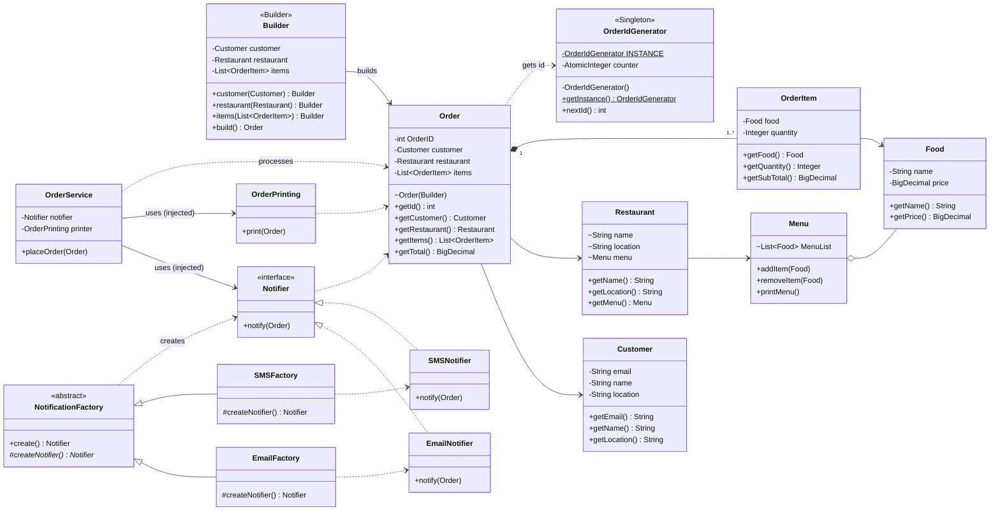

# Food Delivery: SOLID Refactoring Report
 
## 1. Project idea
 
A simple food delivery app: a **customer** orders **food** from a **restaurant**, the order is **placed**, the customer is **notified**, and the order details are **printed**.
 
## 2. What was done
 
| # | Change | Before | After |
|---|---|---|---|
| 1 | `Order` now holds a **list** of items | one `OrderItem` only | `List<OrderItem>`, immutable copy via `List.copyOf` |
| 2 | Total calculation | missing | `OrderItem.getSubTotal()` and `Order.getTotal()` |
| 3 | Money type | `float` | `BigDecimal` (exact, safe for prices) |
| 4 | Printing removed from `Order` | `Order.finalOrderDeatails()` printed itself | new `OrderPrinting` class |
| 5 | Notification abstraction | hardcoded `Notification` class | `Notifier` interface + `EmailNotifier` and `SMSNotifier` |
| 6 | Order workflow | empty `OrderService` | `OrderService.placeOrder(order)` coordinates notify + print |
| 7 | Dependency injection | none | `OrderService` receives `Notifier` and `OrderPrinting` through its constructor |
| 8 | `Main` role | built and printed everything | only creates objects, wires them, and starts the flow |
 
## 3. SOLID principles used
 
### S: Single Responsibility
Each class has one job:
- `Order`, `OrderItem`, `Customer`, `Food`: hold data (and compute their own totals)
- `OrderPrinting`: output formatting only
- `EmailNotifier`, `SMSNotifier`: sending one kind of notification each
- `OrderService`: coordinating the steps of placing an order
### O: Open/Closed
New notification channels (push, Telegram, ...) are added by **creating a new class** that implements `Notifier`. `OrderService` does not need to be edited.
 
### D: Dependency Inversion
`OrderService` depends on the `Notifier` **interface**, not on `EmailNotifier`. The concrete class is chosen in `Main` and injected through the constructor:
 
```java
OrderService service = new OrderService(new EmailNotifier(), new OrderPrinting());
```
 
Switching to SMS is a one-word change in `Main`: `new SMSNotifier()`.
 
### L: Liskov Substitution
`EmailNotifier` and `SMSNotifier` can replace each other anywhere a `Notifier` is expected, and `OrderService` works the same.
 
### I: Interface Segregation
`Notifier` has a single method, `notify(Order)`. Implementations are not forced to provide methods they do not need.
 
## 4. Class diagram
 

 
## 5. Flow of `placeOrder`
 
```
Main --creates--> EmailNotifier, OrderPrinting
Main --injects--> OrderService(notifier, printer)
Main --calls----> orderService.placeOrder(order)
                    ├─ notifier.notify(order)   (Email or SMS, decided by Main)
                    └─ printer.print(order)
```
 

 
## 6. Conclusion

In this lab, I learned the theoretical concepts of the SOLID principles and applied some of them to develop a simple food delivery project. I gained a better understanding of how to organize classes, separate responsibilities, and reduce dependencies between components. By implementing these principles, I learned how to make the code more readable, maintainable, and easier to extend with new functionality. This lab helped me understand the importance of good object-oriented design when developing software projects.


# Food Delivery: Creational Design Patterns Report
 
## 1. Project idea
 
A simple food delivery app: a **customer** orders **food** from a **restaurant**, the order is **placed**, the customer is **notified**, and the order details are **printed**.

In this lab the project from the previous lab was extended with three **creational design patterns**: **Builder**, **Factory Method** and **Singleton**.
 
## 2. What was done
 
| # | Change | Before | After |
|---|---|---|---|
| 1 | Creating an `Order` | `new Order(customer, restaurant, items)` | `Order.Builder` with chained methods and `build()` |
| 2 | Order identification | none | every order gets a unique `OrderID` |
| 3 | Unique id generation | none | `OrderIdGenerator` as a **Singleton** |
| 4 | Choosing the notifier | `Main` wrote `new EmailNotifier()` | `NotificationFactory` + `EmailFactory` and `SMSFactory` |
| 5 | `OrderService` creation | `new OrderService(new EmailNotifier(), ...)` | `new OrderService(factory.create(), ...)` |
| 6 | `Restaurant` | fields only | added `getName()`, `getLocation()`, `getMenu()` |
| 7 | `OrderPrinting` | no id, no restaurant details | prints the order id, the restaurant and its menu |
| 8 | Singleton comparison | none | `SingletonEager` and `SingletonLazy` in the `test/` folder |
 
## 3. Creational patterns used
 
### Builder
`Order` is made of several parts (customer, restaurant, items). Instead of a long constructor, the nested class `Order.Builder` collects the parts with chained methods, and `build()` creates the final `Order`. The `Order` constructor is not public, so an order can only be created through the builder.

```java
Order order = new Order.Builder()
        .customer(customer1)
        .restaurant(restaurant1)
        .items(List.of(new OrderItem(item3, 2)))
        .build();
```

New fields (note, delivery address, fee) can be added later as new builder methods without changing existing code.

### Factory Method
`NotificationFactory` is an abstract class with the factory method `createNotifier()`. `EmailFactory` and `SMSFactory` override it and decide which `Notifier` is created. The code that uses the notifier never writes `new EmailNotifier()`.

```java
NotificationFactory factory = new EmailFactory();
OrderService orderService1 = new OrderService(factory.create(), new OrderPrinting());
```

Switching to SMS is a one-word change in `Main`: `new SMSFactory()`. A new channel is added by creating one new notifier and one new factory, and `OrderService` does not need to be edited.

### Singleton
Every order needs a unique id, so the whole application must share **one** counter. `OrderIdGenerator` has a private constructor and a static instance that is reached only through `getInstance()`. The `Order` constructor asks it for the next id.

```java
this.OrderID = OrderIdGenerator.getInstance().nextId();
```

In the `test/` folder two variants were compared: **eager** initialization (the object is created when the class is loaded) and **lazy** initialization (created on the first `getInstance()` call). `OrderIdGenerator` uses the lazy one.

### Other creational patterns (not used)
**Abstract Factory** creates families of related objects, **Prototype** creates objects by copying an existing one, and **Object Pool** reuses ready objects. They were not needed here, because there is only one product type and nothing expensive to create.
 
## 4. Class diagram
 

 
## 5. Flow of `placeOrder`
 
```
Main --creates--> EmailFactory
Main --calls----> factory.create()  ->  EmailNotifier
Main --injects--> OrderService(notifier, printer)
Main --builds---> Order.Builder ... .build()
                    └─ OrderIdGenerator.getInstance().nextId()
Main --calls----> orderService.placeOrder(order)
                    ├─ notifier.notify(order)
                    └─ printer.print(order)
```
 
## 6. Conclusion

In this lab, I learned the theoretical concepts of creational design patterns and applied three of them to develop a simple food delivery project. The Builder made the creation of an order clearer and easier to extend, the Factory Method removed the choice of a concrete notifier from the code that uses it, and the Singleton guaranteed that only one id generator exists, so order ids are never duplicated. I also compared eager and lazy initialization of a singleton. By combining these patterns with the SOLID principles from the previous lab, I learned how to separate the creation of objects from their usage, which makes the code more flexible, maintainable, and easier to extend with new functionality.